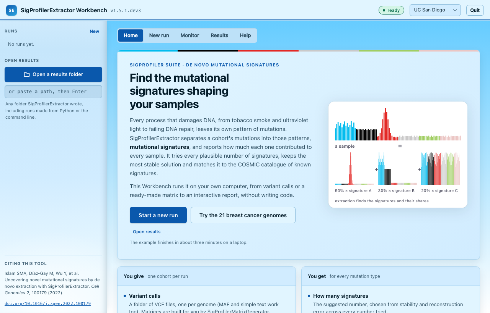
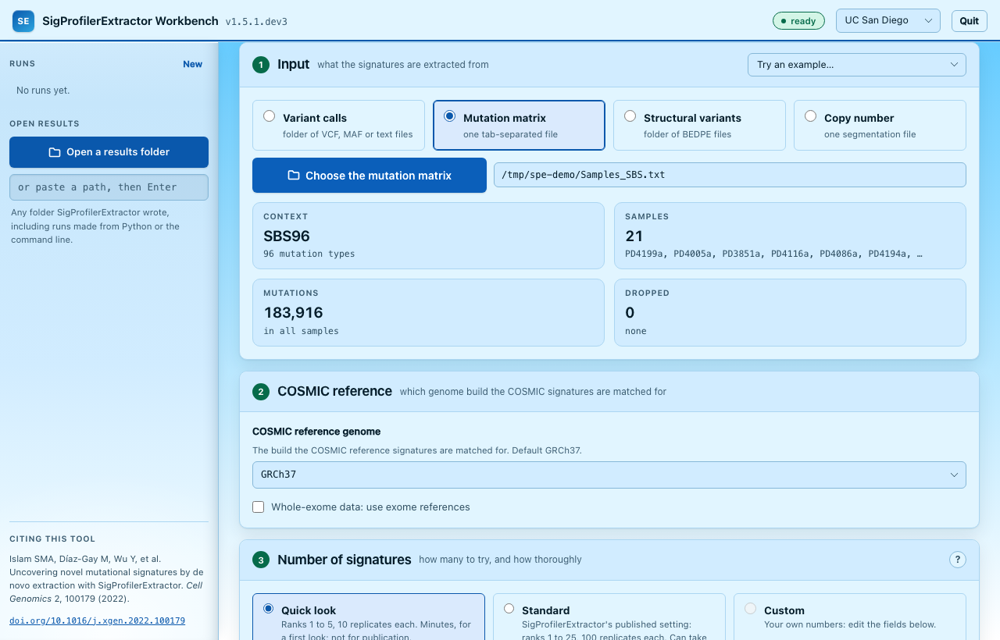
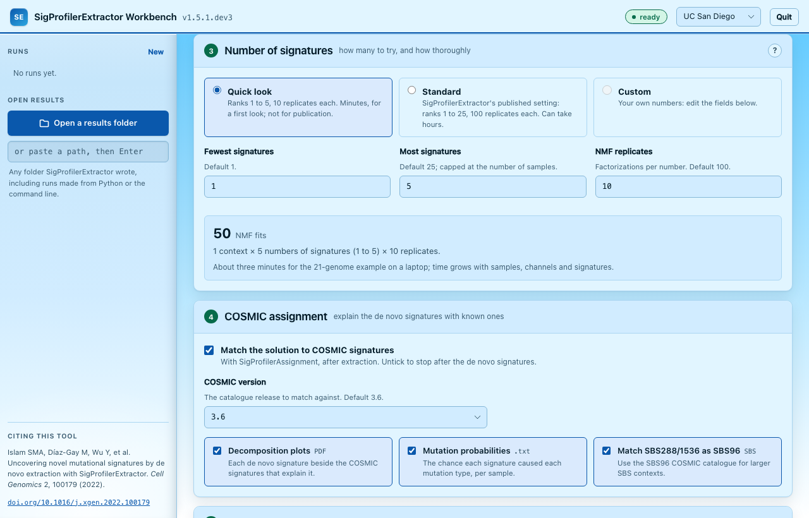
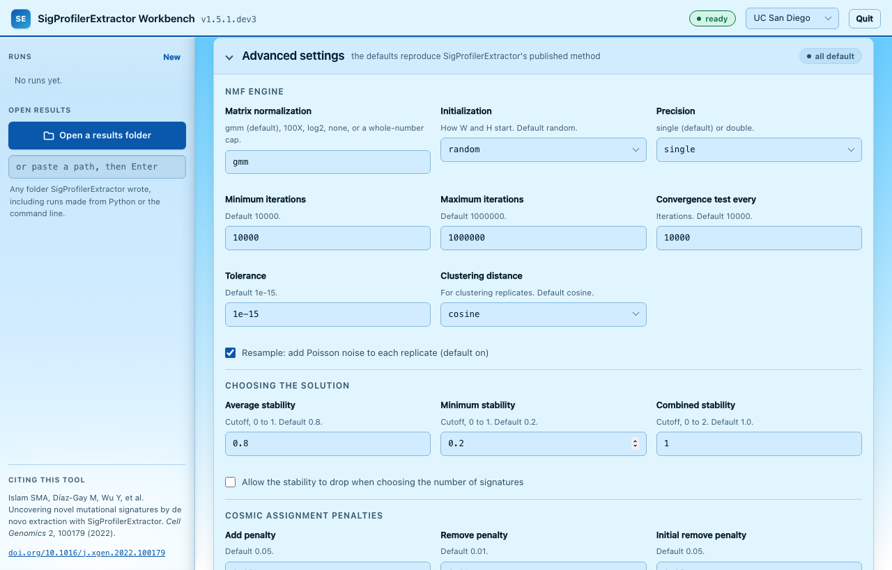
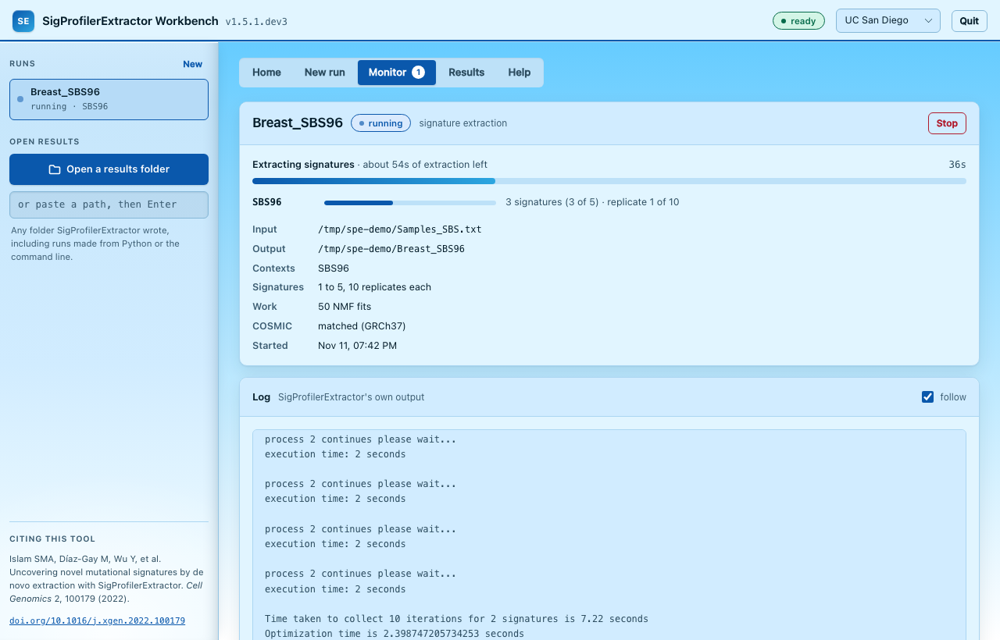
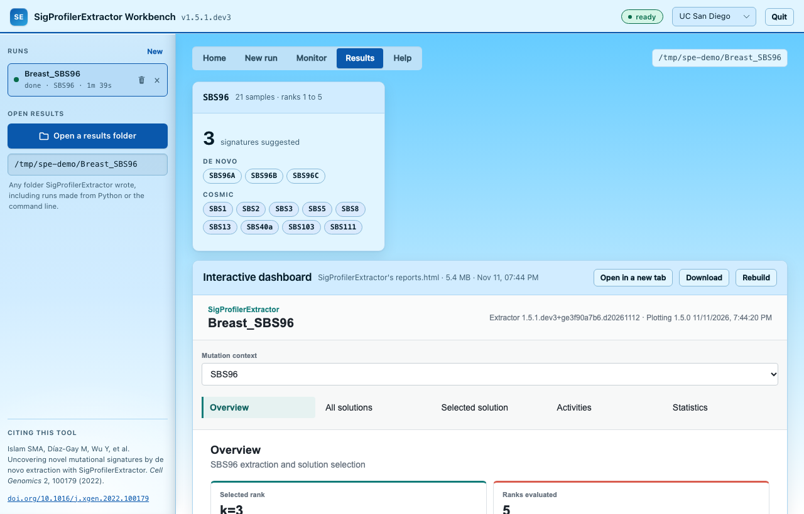
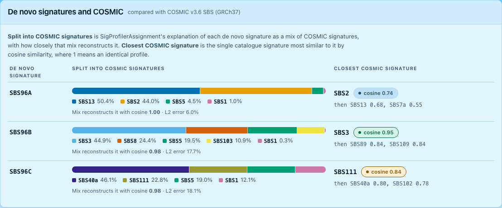
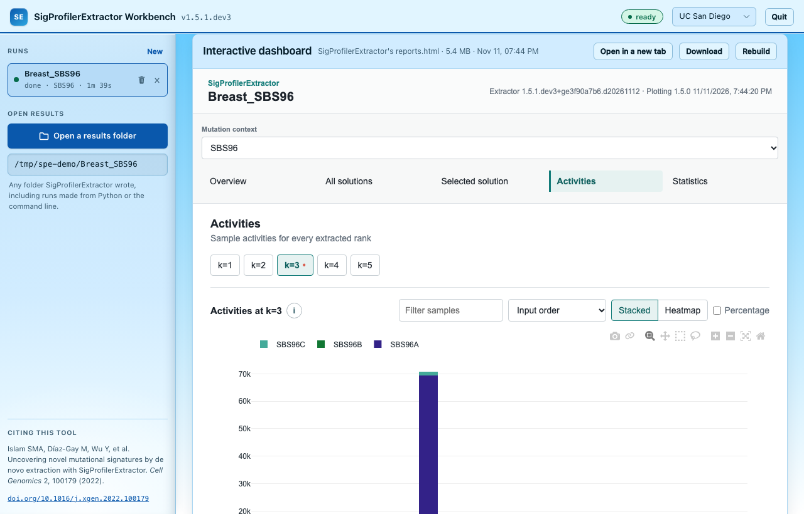
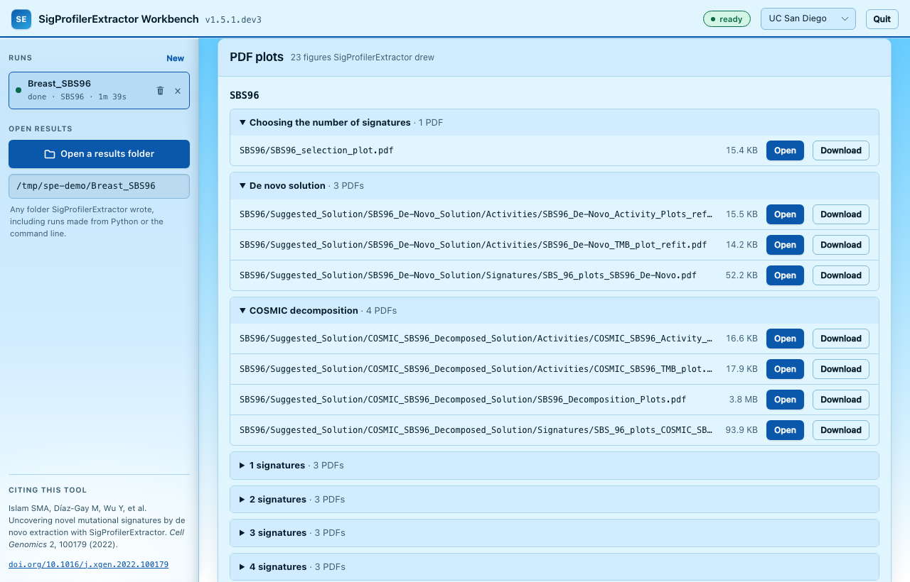

# Graphical Interface (Workbench)

The **SigProfilerExtractor Workbench** runs SigProfilerExtractor from your browser,
without writing code. Choose the input, check the settings, start the run, follow its
progress and explore the results, including the interactive dashboard
SigProfilerExtractor writes for every run.

Everything runs on your own computer: the Workbench is a small server on this machine,
and your browser is its window. Your data never leaves the computer.

It calls the same function as Python and the command line, with the same defaults, so a
run started here writes exactly the files described in
[Using the Tool - Output](4. Using the Tool - Output.md).



## Install and start

The Workbench comes with SigProfilerExtractor: download or clone the
[repository](https://github.com/SigProfilerSuite/SigProfilerExtractor) and start it from
that folder with a double-click. The only requirement is **Python 3.9 or newer**.

=== "macOS"

    1. If Python 3 is not installed, install it from
       [python.org](https://www.python.org/downloads/macos/) (or with Homebrew or conda).
    2. In the SigProfilerExtractor folder, double-click **`launch_web.command`**.
    3. The first time, macOS may say it cannot verify the file: right-click it, choose
       **Open**, then **Open** again. macOS remembers this choice.
    4. A Terminal window opens and sets up the Workbench's private Python environment.
       This takes a few minutes the first time (PyTorch is large) and is skipped
       afterwards.
    5. The Workbench opens in your browser. Keep the Terminal window open while you use
       it; **Quit** in the Workbench's top bar stops it.

=== "Windows"

    1. If Python 3 is not installed, install it from
       [python.org](https://www.python.org/downloads/windows/). Tick **Add python.exe to
       PATH** in the installer (the `py` launcher it installs also works).
    2. In the SigProfilerExtractor folder, double-click **`launch_web.bat`**.
    3. If Windows SmartScreen appears, click **More info**, then **Run anyway**.
    4. A console window opens and sets up the Workbench's private Python environment.
       This takes a few minutes the first time (PyTorch is large) and is skipped
       afterwards.
    5. The Workbench opens in your browser. Keep the console window open while you use
       it; **Quit** in the Workbench's top bar stops it.

=== "Linux"

    In a terminal, in the SigProfilerExtractor folder:

    ```bash
    ./launch_web.sh
    ```

    The first start sets up the private Python environment (a few minutes), then opens
    the Workbench in your browser.

=== "Installed with pip"

    If SigProfilerExtractor is already installed in a Python environment, either command
    starts the Workbench from that environment, with no separate setup:

    ```bash
    SigProfilerExtractor web
    sigprofilerextractor-web
    ```

The browser opens `http://127.0.0.1:<port>/`. A free port is picked on every start, and
the window that started the Workbench prints the address. Starting it while it is
already running prints the address of the running one instead of starting a second.

### What gets installed, and where

| What | Where | Removed by the uninstaller |
|---|---|---|
| A private Python environment with SigProfilerExtractor and its dependencies | `.venv-dashboard`, inside the SigProfilerExtractor folder | yes |
| Reference genomes installed through the Workbench | inside that environment (unless you chose another **Reference files folder**) | yes |
| Run records: each run's settings and log | `~/.cache/sigprofilerextractor` (macOS, Linux), `%LOCALAPPDATA%\SigProfilerExtractor` (Windows) | yes |
| Your results | each run's output folder, by default under `SigProfilerExtractor_results` in your home folder | no |
| Downloaded packages, kept so later installs are quicker | uv's cache: `~/.cache/uv` (macOS, Linux), `%LOCALAPPDATA%\uv\cache` (Windows); or pip's cache if pip was used | no: `uv cache clean` (or `pip cache purge`) empties it |

Nothing else is installed: no system files, services or registry entries. The launcher
reinstalls into its environment only when `setup.py` or `pyproject.toml` changes, for
example after updating the repository.

The launcher installs with [uv](https://docs.astral.sh/uv/), which downloads and installs
packages in parallel and is much quicker than pip for large ones such as PyTorch. It uses
the `uv` already on your PATH if there is one; otherwise it first adds uv to the
Workbench's own environment. If uv cannot be added or cannot install, the launcher says so
and uses pip instead. To always use pip, for example behind a network that only allows
pip's configured package mirror, set the environment variable `SPE_WEB_INSTALLER=pip`.

### Launch options

| Option | Meaning |
|---|---|
| `--no-launch` | Start without opening a browser tab |
| `--stop` | Stop the running Workbench, and any run it started, then exit |
| `--volume PATH` | Folder of installed reference genomes and reference files (the `volume` parameter) |
| `--reinstall` | Force a fresh install into `.venv-dashboard` (launcher scripts only) |

```bash
./launch_web.sh --no-launch      # start without opening a tab
./launch_web.sh --stop           # stop it from another terminal
```

## Home

The Workbench opens on a page that introduces the tool: what it takes, what it gives
back, how the method works, and the runs you made recently. **Try the 21 breast cancer
genomes** fills in a complete run that finishes in a few minutes: the quickest way to see
every part of the Workbench.

## Setting up a run

The **New run** tab is five numbered cards and a collapsed **Advanced settings** card.
A card's number turns green once it is complete. **Start run** stays disabled, and the
line beside it names the first thing still missing, until every card is complete.



!!! tip "Examples"
    **Try an example**, at the top of the Input card, fills in any of the examples that
    ship with SigProfilerExtractor, with the Quick look setting:

    | Example | Input |
    |---|---|
    | 21 breast cancer genomes | SBS96 matrix |
    | 5 genomes from VCFs | variant calls on GRCh37 (copied before the run, since the matrices are written into the input folder) |
    | Doublet substitutions | DBS78 matrix |
    | Small insertions and deletions | ID83 matrix |
    | Copy-number profiles | CNV48 matrix |
    | Structural variants | SV32 matrix |
    | Battenberg segments | copy-number segmentation file |

### 1. Input

Choose the kind of input, then the file or folder (with the button, or by pasting a path
and pressing Enter). The Workbench reads it before anything runs:

| Kind | Choose | The Workbench reports |
|---|---|---|
| Variant calls | a folder of VCF files, one per sample (MAF and simple text also work) | format, samples, mutations and indels, files |
| Mutation matrix | one tab-separated file: mutation types in the first column, one column per sample | the context (from the number of rows), samples, mutations, samples that will be dropped |
| Structural variants | a folder of BEDPE files | samples, variants |
| Copy number | one segmentation file, plus the caller that made it (ASCAT, ASCAT_NGS, Battenberg, FACETS, PURPLE, Sequenza, ABSOLUTE, TCGA) | samples, segments |

A matrix's context follows from its rows, as in SigProfilerExtractor: 96, 288, 384, 1536
or 4608 for SBS, 78 for DBS, 83 for ID, 48 for CNV and 32 for SV. Empty and all-zero
samples are dropped, and the Workbench names them; a sample with only some values
missing would stop the run, so the Workbench refuses it before the run starts.

!!! note
    For variant calls, SigProfilerMatrixGenerator writes `input/` and `output/` folders
    into the folder of calls while it builds the matrices, so that folder must be
    writable.

### 2. Genome and contexts

For variant calls: the reference genome they were called against (installed from the
card if needed, about 3 GB for a human genome, once), the mutation contexts to extract
(SBS96, DBS78 and ID83 by default; SBS288, SBS384, SBS1536 and SBS4608 too), and whether
the data is whole-exome. The card warns if the calls name a different assembly, and when
they hold no indels (ID83 would be skipped).

For other inputs: the genome build of the COSMIC reference signatures. It is set for you
for CNV48 (GRCh37) and SV32 (GRCh38), the builds those COSMIC signatures are defined on.

### 3. Number of signatures



How many signatures to try (the rank), and how many NMF replicates for each:

| Preset | Numbers tried | Replicates | Use |
|---|---|---|---|
| Quick look | 1 to 5 | 10 | a first look at a cohort, in minutes |
| Standard | 1 to 25 | 100 | SigProfilerExtractor's published setting, for results you report |

Editing a field switches to **Custom**. The box under the fields adds up the work:
contexts × numbers of signatures × replicates NMF fits, the main driver of run time. The
largest number is capped at the number of samples, as SigProfilerExtractor does.

### 4. COSMIC assignment

On by default: after extraction, SigProfilerAssignment explains each de novo signature
with COSMIC signatures (v3.6 by default) and assigns them to every sample. The options
choose the decomposition plots, the mutation probability tables, and whether SBS288 and
SBS1536 are matched with the SBS96 catalogue. Untick it to stop after the de novo
signatures (`stop_after_extraction`).

### 5. Output

The folder the results go to, filled in from the input's name. If it already holds a
SigProfilerExtractor run, the run does not start until you choose **Use a new folder**
(the next free name) or **Replace the earlier results**, which deletes only what
SigProfilerExtractor wrote there.

### Advanced settings



Every other parameter, grouped as SigProfilerExtractor reports them, each with its
default:

| Group | Settings |
|---|---|
| NMF engine | matrix normalization, initialization, precision, minimum and maximum iterations, convergence test interval, tolerance, clustering distance, resampling |
| Choosing the solution | average, minimum and combined stability cutoffs; allowing the stability to drop |
| COSMIC assignment penalties | add, remove and initial remove penalties |
| Computer | CPUs for extraction and for assignment; the GPU and its batch size (offered only when a CUDA GPU is present) |
| Reproducibility and outputs | a seeds file to repeat an earlier run exactly (checked when chosen), the dashboard, every replicate's matrices, the reference files folder |

The card's header counts the settings changed from the defaults; **Restore the
defaults** resets them all.

## Following a run

Starting a run opens the **Monitor** tab:



- **Progress** for the whole run, and one row per mutation context: the number of
  signatures being tried, the replicate, and the COSMIC step. Once a few numbers have
  finished, it estimates the extraction time left.
- **Details:** input, output, contexts, the numbers tried and the total work.
- **Log:** SigProfilerExtractor's own output, as it is written. Untick **follow** to
  scroll back while it runs.
- **Stop** ends the run and all its worker processes.

Each run is a separate process, so a long run never slows the page, and runs keep their
records after the Workbench is restarted. Every run is listed in the sidebar under
**Runs**. A finished run has two buttons there and on the Monitor tab:

| Button | What it does |
|---|---|
| **×** (Remove from list) | Takes the run off the list. Its results stay on disk, and **Undo** brings it back. |
| Bin (Delete) | Deletes the run and what SigProfilerExtractor wrote for it, after asking (with the path, file count and size). Other files in the folder stay. This cannot be undone. |

## Exploring results

Open a finished run from Monitor, or click **Open a results folder** in the sidebar and
choose any folder SigProfilerExtractor wrote, including runs made from Python or the
command line.



The **Results** tab shows:

- **One card per mutation context:** the suggested number of signatures, the de novo
  signatures, and the COSMIC signatures that explain them.
- **De novo signatures and COSMIC:** for each de novo signature of the suggested
  solution, two views of how it relates to known signatures:
    - **Split into COSMIC signatures:** SigProfilerAssignment's decomposition of the
      signature into a mix of COSMIC signatures, as a bar with each signature's share,
      and how closely that mix reconstructs it (cosine similarity and L2 error).
    - **Closest COSMIC signature:** the single COSMIC signature most similar to it by
      cosine similarity, with the next two. It is compared with the same catalogue
      the assignment used (the COSMIC version, genome build and exome setting of the
      run); SBS288 and SBS1536 signatures are compared as SBS96. Green marks a cosine
      of 0.9 or more, usually read as the same signature; amber 0.8 to 0.9.

    A signature with a good split but no close single match is a mix of known
    signatures; one with a close match is essentially that known signature.
- **The interactive dashboard:** SigProfilerExtractor's own `reports.html`, shown as it
  is. Its tabs cover the overview and how the number of signatures was chosen, every
  solution tried, the selected solution (de novo and COSMIC), the activities in every
  sample and the statistics. **Open in a new tab** gives it the whole window, and
  **Download** saves it: it is a single file that needs nothing else, ready to share.
  A folder without one (older runs, or runs with the dashboard turned off) offers
  **Build the dashboard**, which writes it from the files there.
- **PDF plots:** the selection plot, the suggested solution's signatures and activities,
  the COSMIC decomposition plots, and each number of signatures tried. **Open** shows a
  PDF in a new tab.
- **Tables and run files:** signatures, activities, statistics, the COSMIC mapping,
  `JOB_METADATA.txt` and `Seeds.txt`.





!!! tip "More room for the results"
    Both side panels, the Workbench's (runs and results folders) and the dashboard's
    (context and views), can be resized or hidden:

    - **Drag the edge** of a panel to make it wider or narrower; drag it all the way left
      to hide it.
    - **Click the panel button** (the square icon at the far left of the top bar, and
      beside the dashboard's title) to hide or show the panel in one click.
    - **Double-click the edge**, or focus it and use the arrow keys, Home and End, to do
      the same from the keyboard.

    With both hidden, the dashboard and its charts use the full window. The Workbench
    remembers its panel's width and whether it is hidden. On narrow screens the panels
    sit above or below the content instead, so there is nothing to resize. A dashboard
    built before this feature has no panel controls; **Rebuild** writes it again with
    them.



## Uninstall

The Workbench installs nothing outside the places listed under
[What gets installed, and where](#what-gets-installed-and-where).

### With a double-click

1. Click **Quit** in the Workbench. (The uninstaller refuses to run while the Workbench
   or one of its runs is still going.)
2. In the SigProfilerExtractor folder, double-click **`uninstall_web.command`** (macOS)
   or **`uninstall_web.bat`** (Windows). On Linux, run `./uninstall_web.sh`. The same
   first-time prompts as for starting may appear: right-click and **Open** on macOS;
   **More info**, then **Run anyway** on Windows.
3. It lists what it will remove and asks before doing anything:

    ```text
      SigProfilerExtractor Workbench uninstaller
      ------------------------------------------
      This removes:
        - the Python environment /path/to/SigProfilerExtractor/.venv-dashboard (1.9G)
          including the reference genomes installed in it: GRCh37
        - the records of 3 run(s) in ~/.cache/sigprofilerextractor (settings and logs, not results)

      It keeps your results (each run's output folder, such as ~/SigProfilerExtractor_results)
      and this folder (/path/to/SigProfilerExtractor).

      Remove them? Type y and press Enter:
    ```

4. Type **y** and press Enter. To remove the rest, delete the SigProfilerExtractor folder
   and, if you no longer need them, your results.

Double-clicking `launch_web.command` or `launch_web.bat` again later sets everything up
anew.

### By hand

1. Click **Quit** in the Workbench.
2. Delete the `.venv-dashboard` folder inside the SigProfilerExtractor folder.
3. Delete the run records: `~/.cache/sigprofilerextractor` on macOS and Linux,
   `%LOCALAPPDATA%\SigProfilerExtractor` on Windows.

## Themes

The menu in the top bar switches between **UC San Diego**, **UAlbany**,
**SigProfilerSuite** and **Night**. The choice is remembered by your browser. The
dashboard keeps its own light style in every theme.

## Security

The Workbench is meant for one person on their own computer. It listens only on
`127.0.0.1` and has no login, so it protects itself in other ways:

- It answers only requests addressed to this machine by name.
- Anything that acts (starting or stopping a run, installing a genome, building a
  dashboard, opening a file picker, quitting) must come from the Workbench's own page,
  carrying a secret written into that page when it starts.
- The dashboard runs in a sandbox: it cannot read the Workbench's page, call the
  Workbench, or load anything from the network.

The Workbench can read any folder you can and starts processes on your behalf, so do not
expose it on a network.

## Troubleshooting

**"Python 3 was not found."** Install Python 3.9 or newer (see
[Install and start](#install-and-start)), then double-click the launcher again.

**macOS says the file cannot be opened, or is from an unidentified developer.**
Right-click the file, choose **Open**, then **Open** again.

**Windows protected your PC.** Click **More info**, then **Run anyway**.

**The first start takes a long time.** It installs SigProfilerExtractor's dependencies,
PyTorch among them, once.

**The page stopped responding after a restart.** Each start uses a new address. Use the
address the launcher printed, or double-click the launcher again: if the Workbench is
already running, it prints that address.

**A VCF run stops with a genome error.** Install the genome from the Genome card, or
point **Reference files folder** (Advanced) at the folder where it is installed.

**The Results tab says the run did not finish.** The run stopped or failed, and the
files it wrote may be incomplete. Its log is on the Monitor tab.

**The uninstaller says the Workbench is still running.** Click **Quit** in the Workbench
(or run `./launch_web.sh --stop`, or `launch_web.bat --stop`), then run it again.
