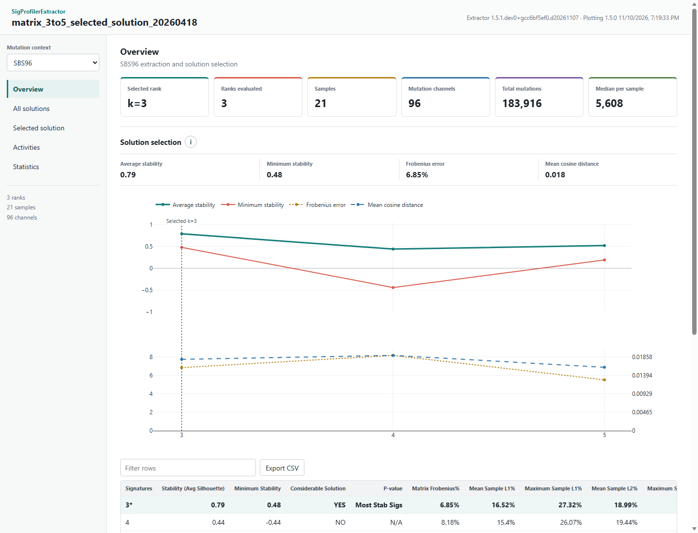

# Interactive Dashboard

SigProfilerExtractor creates `reports.html` after all requested mutation contexts and assignment steps complete. The report is a self-contained interactive dashboard: Plotly, the extracted result data, and the dashboard application are embedded in one file.

Double-click `reports.html` to open it in a modern browser. No web server is required, and the report does not send result data over the network.



## Dashboard Views

Use the mutation-context selector to move between SBS, DBS, ID, CNV, SV, or other completed contexts. The navigation tabs separate cohort-level interpretation from rank-specific output.

### Overview

The Overview summarizes the active mutation context:

- selected signature rank and number of ranks evaluated;
- sample and mutation-channel counts;
- total cohort mutations and median mutations per sample;
- selected-rank stability and reconstruction evidence; and
- mutation burden for each sample.

The solution-selection figure separates metrics with different scientific meanings:

- **Average and minimum stability** are shown in the upper panel. Values nearer 1 indicate that signatures were recovered more consistently across NMF replicates.
- **Matrix Frobenius error** and **mean cosine distance** are shown in the lower panel on explicitly labelled scales. Lower values indicate closer reconstruction of the input matrix.
- The vertical reference line identifies the rank selected by SigProfilerExtractor.

Rank selection should balance stability and reconstruction quality. The lowest reconstruction error is not necessarily the most reliable solution when replicate stability is poor.

### All Solutions

The All Solutions view exposes every evaluated rank. Select `k` to inspect:

- the context-specific signature profile rendered by SigProfilerPlotting;
- the source signature matrix; and
- per-signature statistics for that rank.

Signature profiles describe the relative mutation-channel distribution of a signature. They do not describe how frequently that signature occurs in a sample; use the Activities view for sample attribution.

### Selected Solution

The Selected Solution view contains the final de novo solution and, when generated, the COSMIC decomposition. It provides:

- selected signature profiles;
- selected signature activities;
- de novo-to-COSMIC mappings; and
- tables produced during refitting and decomposition.

Use the **De novo** and **COSMIC decomposition** controls to distinguish extracted patterns from their reference-signature interpretation.

### Activities

The Activities view presents the signature-attribution matrix for every evaluated rank.

- **Stacked** shows absolute mutation counts attributed to each signature and sample.
- **Percentage** normalizes each sample to 100%, which is useful for comparing composition when mutation burdens differ substantially.
- **Heatmap** supports rapid comparison across many samples and signatures.
- **Log color** applies `log10(value + 1)` to heatmap colors while preserving original values in hover labels. This reveals low activities without changing the underlying data.
- Samples can remain in input order, be sorted by mutation burden, or be sorted by name.

Absolute and percentage activities answer different questions. Percentage mode should not be used to compare total signature burden between samples.

### Statistics

The Statistics view contains separate figures and source tables for:

- signature stability and burden;
- per-sample reconstruction quality; and
- NMF replicate convergence diagnostics.

Each figure displays one metric at a time to avoid combining incompatible units on one axis. Use the metric selector to change the measurement. Dashed reference lines show the median when multiple observations are available.

For sample-fit metrics, cosine similarity and correlation nearer 1 indicate better agreement. L1, L2, KL divergence, and cosine distance are errors or distances, where lower values indicate a closer fit.

## Interactive Controls

All figures support Plotly hover labels, zoom, pan, axis reset, and SVG export. Use the circular information button beside a figure title for a description of its axes, interpretation, and source file.

Tables support:

- text filtering;
- ascending and descending sorting by mouse or keyboard;
- sticky column headers; and
- CSV export of the complete table.

Dashboard view URLs are bookmarkable. For example, `reports.html#activities` opens the Activities view and `reports.html#statistics` opens Statistics.

## Create or Refresh a Dashboard

Dashboard generation is enabled by default. To create or refresh `reports.html` for an existing completed output directory without rerunning extraction:

```python
from SigProfilerExtractor.dashboard import create_dashboard

create_dashboard("results")
```

To skip dashboard generation during extraction:

=== "Python"

    ```python
    sig.sigProfilerExtractor(
        input_type="matrix",
        output="results",
        input_data="samples.tsv",
        make_dashboard=False,
    )
    ```

=== "Command line"

    ```bash
    SigProfilerExtractor sigprofilerextractor matrix results samples.tsv \
        --make_dashboard false
    ```

## Data Handling and Reproducibility

`reports.html` embeds result matrices, Plotly figure definitions, `JOB_METADATA.txt`, and the exact root seed from `Seeds.txt`. The dashboard works offline and does not load scripts, fonts, analytics, or result data from external services.

Because all content is embedded, reports with many contexts, ranks, or high-dimensional signatures can be large. Keep the report with the corresponding result directory so its provenance remains clear. Treat it as sensitive research output when sample identifiers or unpublished results are present.

The dashboard is an exploratory companion to the tabular SigProfilerExtractor output. Quantitative reporting and downstream analysis should use the source matrices and statistics files, which remain the authoritative results.
